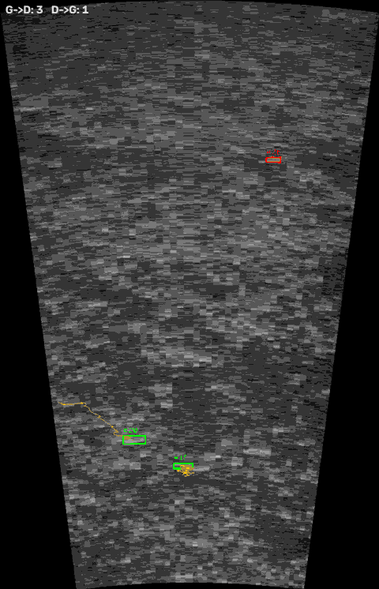

# FediSonar

Détection, suivi et comptage de poissons dans des vidéos de sonar imageur, par une chaîne
**classique** (OpenCV + NumPy, sans apprentissage), évaluée sur le
[Caltech Fish Counting Dataset](https://github.com/visipedia/caltech-fish-counting).

[](docs/demo_strate3_20s.mp4)

*Extrait de 8 s d'un clip de test, strate 3 ([vidéo complète, 20 s](docs/demo_strate3_20s.mp4)) :
9 poissons annotés, 8 comptés sur le clip. Vert = piste comptée, rouge = piste rejetée, jaune = trajectoire,
compteurs par sens en haut à gauche.*

## Objectif

Construire une **baseline** de comptage simple, explicable et mesurée honnêtement, avant
tout modèle de deep learning. Elle sert de point de comparaison pour un futur détecteur
appris, dans la perspective de la détection d'anguilles au sonar.

## Données : CFC, Kenai channel

- **Source** : Caltech Fish Counting Dataset (Kay et al., ECCV 2022), saumons filmés au
  sonar ARIS dans la rivière Kenai (Alaska).
- **Sous-ensemble utilisé** : `kenai-channel`, **69 clips**, 13 159 images JPG en niveaux
  de gris, 8 images/s, de 118 à 200 images par clip (15 à 25 s).
- **Trois strates de portée**, avec des tailles d'image différentes mais une **même
  résolution d'environ 137 px/m** :

  | Strate | Taille d'image | Champ couvert |
  |---|---|---|
  | 1 | ~216 × 485 px | ~1,6 × 3,5 m |
  | 2 | ~427 × 826 px | ~3,1 × 6,1 m |
  | 3 | ~706 × 1097 px | ~5,2 × 8,1 m |

- **Vérité terrain** : annotations au format MOTChallenge (`gt.txt`). Le nombre de
  poissons d'un clip est le nombre d'identifiants de piste distincts. Les 69 clips
  contiennent 381 poissons annotés.

Les données ne sont pas incluses dans ce dépôt. On télécharge les métadonnées,
les annotations et l'archive `channel.tar` (1,7 Go) depuis CaltechDATA, puis on les place dans `data/`
(`data/channel/`, `data/annotations/`, `data/metadata/`).

## Méthode

Tout le traitement est dans [`fedisonar.py`](fedisonar.py), en trois étapes.

1. **Détection.** Un flou gaussien atténue le speckle. Le fond est la **médiane de
   toutes les images du clip** : un poisson ne reste pas au même endroit la plupart du
   temps, donc la médiane donne le fond sans poisson, dès la première image. Est gardé
   ce qui est plus clair que le fond d'au moins 30 niveaux de gris (un poisson renvoie
   plus d'écho). Une ouverture puis une fermeture morphologiques nettoient le masque, et
   les taches de moins de 125 px sont écartées.
   L'option `--fond mog2` utilise à la place le fond appris au fil des images (MOG2),
   compatible avec un traitement en direct.
2. **Suivi.** Les centres des taches sont associés d'une image à l'autre au plus proche
   voisin (60 px au plus). Une piste se termine après 8 images sans détection.
3. **Comptage.** Une piste est comptée si elle dure au moins 10 images (1,25 s) et se
   déplace horizontalement d'au moins 2 % de la largeur de l'image. Le sens du
   déplacement (gauche→droite ou droite→gauche) est relevé.

Sorties : une vidéo annotée et un CSV d'une ligne par poisson compté.

## Protocole d'évaluation

- **Découpage fixe** des 69 clips (graine 0), fait une fois pour toutes :
  - **23 clips de réglage** (149 poissons) : 11 en strate 1, 3 en strate 2, 9 en strate 3 ;
  - **46 clips de test** (232 poissons) : 24 en strate 1, 12 en strate 2, 10 en strate 3.
- **Critère** : erreur absolue de comptage, somme sur les clips de |comptés − annotés|.
  L'erreur relative est cette somme divisée par le nombre de poissons annotés.
- **Réglage** ([`tune.py`](tune.py)) : recherche exhaustive sur une grille, **sur le groupe
  de réglage uniquement**. Paramètres explorés : méthode de fond et seuil (MOG2 16 / 25 / 40,
  médiane 10 à 50), aire minimale (relative à l'image ou en pixels), déplacement minimal
  (0 à 40 % de la largeur), durée minimale (3 à 15 images). La grille a été élargie une
  fois, parce que deux valeurs retenues étaient en bordure. L'optimum final est à
  l'intérieur de la grille.
- **Test** : les paramètres ont été figés, puis mesurés **une seule fois** sur le groupe
  de test ([`report.py`](report.py)). Seule exception : un clip de test a servi à
  chronométrer le traitement, sans rien en tirer pour le réglage.

| | Fond | Aire min. | Déplacement min. | Durée min. |
|---|---|---|---|---|
| **Avant** (réglages initiaux) | MOG2, seuil 40 | 150 px | 80 px | 10 images |
| **Après** (réglés) | médiane, seuil 30 | 125 px | 2 % de la largeur | 10 images |

Sur le groupe de réglage, l'erreur absolue passe de 98 à 34.

## Résultats sur le groupe de test

Erreur signée = comptés − annotés : **> 0, on compte trop ; < 0, on ne compte pas assez**.

| Strate | Clips | Annotés | Avant : comptés | Avant : signée | Avant : absolue | Avant : relative | Après : comptés | Après : signée | Après : absolue | Après : relative |
|---|---:|---:|---:|---:|---:|---:|---:|---:|---:|---:|
| 1 | 24 | 88 | 66 | −22 | 46 | 52,3 % | 74 | −14 | 28 | 31,8 % |
| 2 | 12 | 56 | 18 | −38 | 38 | 67,9 % | 74 | +18 | 18 | 32,1 % |
| 3 | 10 | 88 | 22 | −66 | 66 | 75,0 % | 81 | −7 | 23 | 26,1 % |
| **Total** | **46** | **232** | **106** | **−126** | **150** | **64,7 %** | **229** | **−3** | **69** | **29,7 %** |

Les réglages initiaux comptaient beaucoup trop peu, surtout dans les grandes images
(strates 2 et 3). L'erreur relative est maintenant de 26 à 32 % dans chaque strate.

### Seuils retenus en unités physiques

Les conversions utilisent la résolution de chaque clip, donnée par ses métadonnées.

| Strate | Résolution | Aire minimale (125 px) | Déplacement minimal (2 % de la largeur) |
|---|---|---|---|
| 1 | 138 px/m | 66 cm² | 3 cm |
| 2 | 136–137 px/m | 67 cm² | 6 cm |
| 3 | 135–136 px/m | 68 cm² | 10 cm |

L'aire minimale correspond à une tache d'environ 8 × 8 cm, la même dans toutes les
strates. C'est pourquoi elle est exprimée en pixels : une aire relative à la taille
de l'image donnait un seuil environ 7 fois plus élevé en strate 3, et faisait moins bien
au réglage (34 contre 42). Le déplacement minimal, de 3 à 10 cm, est presque inactif. Il
élimine surtout les taches immobiles ; l'essentiel du tri vient de la durée et de la taille.

## Limites

- **Les erreurs se compensent dans le total.** L'erreur signée totale de −3 cache un excès
  en strate 2 (+18) et un déficit en strates 1 et 3. L'erreur absolue (69) est le bon
  indicateur.
- **La strate 2 est peu représentée au réglage** : 3 clips seulement, contre 12 au test.
  C'est probablement la cause de l'excès de comptage dans cette strate.
- **Le réglage repose sur peu de données.** Sur 23 clips, les dix meilleurs réglages sont
  entre 34 et 39 d'erreur : le choix entre eux tient en partie au hasard.
- **Seul le nombre est évalué**, pas la position des poissons ni la qualité des pistes
  (aucune métrique de suivi, de type MOTA ou HOTA). Un compte juste peut venir d'erreurs
  qui s'annulent dans un même clip.
- **La vérité terrain compte toutes les pistes annotées**, y compris les poissons qui ne
  traversent pas tout le champ. La règle de comptage n'est donc pas exactement celle des
  annotateurs.
- **Le fond médian suppose un clip enregistré** et des poissons qui ne stationnent pas.
  Un poisson immobile pendant plus de la moitié du clip se confond avec le fond. Certaines
  pistes durent tout le clip, et pourraient correspondre à un tel cas.
- **Un seul site** (Kenai channel) et une seule espèce (saumon). Rien ne garantit les mêmes
  réglages ailleurs, en particulier pour des anguilles, plus fines et plus longues.
- **Le sens amont/aval n'est pas connu** : les métadonnées de ce site ne donnent pas la
  direction de l'amont. Seuls les sens gauche→droite et droite→gauche sont relevés.

## Prochaines étapes

1. **Séparation stratifiée** : faire le découpage réglage/test strate par strate, pour
   que chaque strate pèse autant dans les deux groupes. On pourrait aussi faire une
   validation croisée, pour estimer la variabilité du résultat.
2. **Critères de forme** : utiliser la résolution (px/m) pour filtrer les taches sur des
   grandeurs physiques. Par exemple, une longueur entre deux bornes en cm, un rapport
   longueur/largeur, une orientation alignée sur le déplacement. C'est aussi la voie vers
   les anguilles, dont la silhouette allongée est très caractéristique.
3. **Détecteur appris** : remplacer la soustraction de fond par un petit détecteur léger,
   utilisable sur CPU, entraîné sur les annotations CFC d'autres sous-ensembles
   (`kenai-train`). On garderait le même suivi et le même protocole d'évaluation, pour
   comparer à cette baseline.

## Utilisation

Prérequis : Python 3.13, puis `pip install -r requirements.txt`.

```powershell
python fedisonar.py --demo                 # vidéo synthétique de contrôle : doit compter 5/5
python fedisonar.py <nom_du_clip>          # un clip CFC -> outputs/<clip>_annotee.mp4 et _pistes.csv
python fedisonar.py video.mp4 --fond mog2  # une vidéo, fond appris au fil de l'eau
python evaluate.py --groupe test           # comptés / annotés par clip, sur le groupe de test
python tune.py                             # réglage (groupe de réglage uniquement, ~10 min)
python report.py                           # tableau avant/après par strate et seuils physiques
```

| Fichier | Rôle |
|---|---|
| `fedisonar.py` | détection, suivi, comptage, vidéo annotée |
| `evaluate.py` | comparaison à la vérité terrain, découpage réglage/test |
| `tune.py` | recherche des paramètres sur le groupe de réglage |
| `report.py` | tableau final sur le groupe de test |

## Référence

Justin Kay, Peter Kulits, Suzanne Stathatos, Siqi Deng, Erik Young, Sara Beery, Grant Van Horn,
Pietro Perona. *The Caltech Fish Counting Dataset: A Benchmark for Multiple-Object Tracking
and Counting.* ECCV 2022.

Auteur : Fedi Limem.
